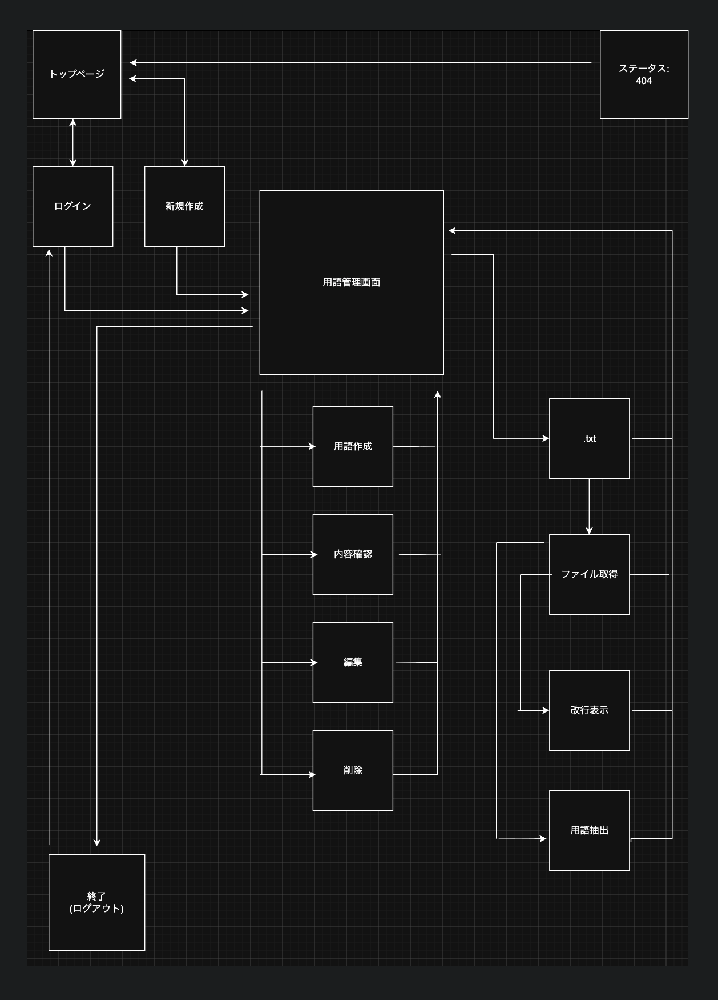

# プロジェクト名

IT用語管理アプリ

## 概要

このプロジェクトは
IT用語の情報整理のために開発しました.

### 製作理由

- IT用語には類似語が多く,意味を把握しづらい.
- 生成AIで効率的にIT用語を取得しつつ，ハルシネーションにも対応したい.

## 主な機能

| No  | メモ機能 |
| --- | -------- |
| 1   | 作成     |
| 2   | 保存     |
| 3   | 編集     |
| 4   | 削除     |

| No  | 認証機能             |
| --- | -------------------- |
| 1   | アカウント登録       |
| 2   | ログイン             |
| 3   | ログアウト           |
| 4   | ユーザー認証         |
| 5   | ユーザー間の閲覧制限 |

| No  | .txt入出力         |
| --- | ------------------ |
| 1   | .txt取得           |
| 2   | .txt出力           |
| 3   | 改行表示           |
| 4   | アルファベット抽出 |

## 技術スタック

| カテゴリ       | 技術                          |
| -------------- | ----------------------------- |
| フロントエンド | HTML / CSS / JavaScript       |
| バックエンド   | Python                        |
| データベース   | SQLite                        |
| ORM            | Flask-SQLAlchemy / SQLAlchemy |
| フレームワーク | Flask                         |
| 認証           | Flask-Login                   |
| テスト         | pytest                        |

## はじめ方

### 動作確認環境

- macOS Tahoe 26.6.2

### ライブラリ環境

- Python 3.14.7
- pip 26.2.1
- Flask 3.1.3

### セットアップ

クローン構築, 仮想環境構築, 起動準備, 起動, テストなどについては以下をご参照ください.

### クローン構築

```bash
git clone https://github.com/SusumeYukichi/py_flask_app.git
```

```bash
cd py_flask_app
```

### 仮想環境構築

```bash
python3 -m venv .venv
```

```bash
source .venv/bin/activate
```

### 起動準備

```bash
python3 -m pip install -r requirements.txt
```

### 環境変数を設定

```bash
cp .env.example .env
```

.env を編集して必要な値の設定をお願いします.

```bash
flask db upgrade
```

### 起動

```bash
flask run
```

```bash
http://127.0.0.1:5000
```

上記でアプリケーションにアクセスできます.

### テスト実行

```bash
python3 -m pytest
```

## 画面遷移図

本アプリケーションの主要な画面遷移を以下に示します。


